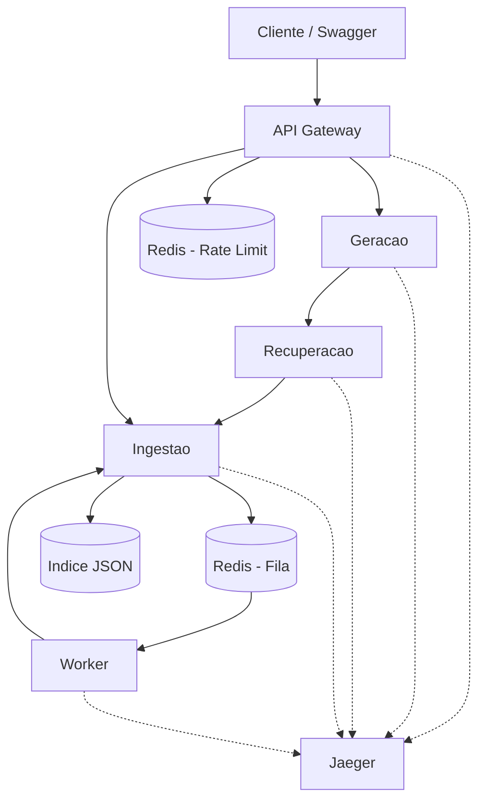
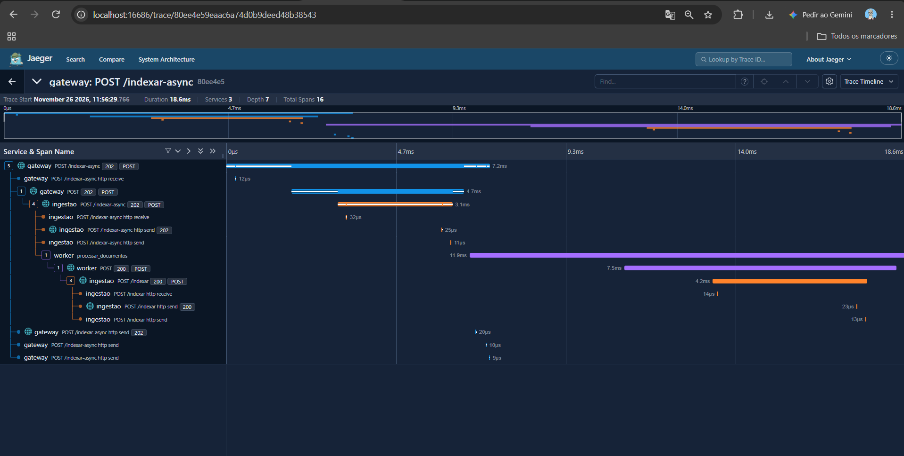

# C3.A2 — Plataforma de IA como Serviço

**Sistemas Distribuídos e Computação em Nuvem — FAESA — 2026/2**

Professor: Howard Cruz Roatti

## 1. Sobre o projeto

O projeto consiste em uma plataforma distribuída de inteligência
artificial baseada em RAG (Retrieval-Augmented Generation),
desenvolvida a partir das atividades realizadas durante a disciplina.

A aplicação utiliza uma arquitetura de microsserviços,
conteinerização com Docker, comunicação REST, mensageria com
Redis, autenticação JWT, mecanismos de resiliência e
rastreamento distribuído com OpenTelemetry e Jaeger.

O objetivo é demonstrar a integração dos conceitos de
sistemas distribuídos em uma aplicação cloud-native.

## 2. Tecnologias utilizadas

- Python
- FastAPI
- Docker e Docker Compose
- Redis
- PyJWT
- Scikit-learn e TF-IDF
- OpenTelemetry
- Jaeger
- Railway
- Git e GitHub

## 3. Arquitetura do sistema



### Componentes

| Componente | Responsabilidade |
|---|---|
| Gateway | Autenticacao, rate limit e roteamento |
| Ingestao | Indexacao e persistencia de documentos |
| Recuperacao | Busca de documentos por similaridade |
| Geracao | Geracao de respostas com contexto |
| Worker | Processamento assincrono de documentos |
| Redis | Fila de mensagens e rate limit |
| Jaeger | Rastreamento distribuido |

O Gateway funciona como ponto único de entrada da
aplicação. Os microsserviços internos não precisam
ser acessados diretamente pelo cliente.

## 4. Deploy em nuvem

A aplicação está publicada no Railway com HTTPS.

URL pública:

https://sd-2026-2-kit-c3a2-production-bc549286.up.railway.app

Documentação interativa (Swagger):

https://sd-2026-2-kit-c3a2-production-bc549286.up.railway.app/docs

O login, a consulta RAG e a indexação assíncrona via
fila e worker foram validados no ambiente publicado.

O usuário de demonstração pode ser obtido com os
integrantes do grupo.

### Configuração no Railway

Cada microsserviço é um serviço do Railway criado a partir
deste repositório, sem Root Directory, com o Dockerfile
indicado na variável `RAILWAY_DOCKERFILE_PATH`, além de um
Redis gerenciado. Somente o Gateway possui domínio público
com HTTPS; os demais se comunicam pela rede privada
(`*.railway.internal`).

| Serviço | Dockerfile | Variáveis |
|---|---|---|
| Gateway | `/servicos/gateway/Dockerfile` | `URL_GERACAO`, `URL_INGESTAO`, `REDIS_URL`, `JWT_SEGREDO`, `USUARIO_DEMO`, `SENHA_DEMO` |
| Geração | `/servicos/geracao/Dockerfile` | `URL_RECUPERACAO` (porta 8003) |
| Recuperação | `/servicos/recuperacao/Dockerfile` | `URL_INGESTAO` (porta 8002) |
| Ingestão | `/servicos/ingestao/Dockerfile` | `REDIS_URL` (porta 8001) |
| Worker | `/servicos/mensageria/Dockerfile` | `REDIS_URL`, `URL_INGESTAO` |
| Redis | Serviço gerenciado do Railway | — |

As URLs internas seguem o formato
`http://<domínio privado>.railway.internal:<porta>` e o
`REDIS_URL` usa a referência `${{Redis.REDIS_URL}}`. Como o
Jaeger roda apenas no ambiente local, a variável
`OTEL_SDK_DISABLED=true` desliga o envio de traces na nuvem.

## 5. Como executar localmente

### Pré-requisitos

- Git
- Docker Desktop
- Docker Compose

### Clonar o repositório

```bash
git clone https://github.com/the-codlx/sd-2026-2-kit-c3a2.git
cd sd-2026-2-kit-c3a2
```

### Configurar as variáveis de ambiente

No Windows PowerShell:

```powershell
Copy-Item .env.example .env
```

No Linux ou macOS:

```bash
cp .env.example .env
```

O arquivo .env deve permanecer fora do controle de versão.
Configure um segredo JWT seguro e as credenciais locais.

A chave de API do LLM é opcional. Sem essa chave,
o sistema funciona em modo simulado.

### Executar todos os serviços

```bash
docker compose up --build -d
```

Verificar os containers:

```bash
docker compose ps
```

Swagger local:

http://localhost:8000/docs

Jaeger local:

http://localhost:16686

O sistema inicia com os três documentos de referência
disponíveis no diretório documentos, caso o índice
ainda esteja vazio.

## 6. Endpoints da API

| Metodo | Rota | JWT | Finalidade |
|---|---|---|---|
| GET | /saude | Nao | Verificar o Gateway |
| POST | /login | Nao | Gerar token JWT |
| POST | /perguntar | Sim | Consultar o RAG |
| POST | /indexar | Sim | Indexar documentos |
| POST | /indexar-async | Sim | Enviar documentos para a fila |
| POST | /simulacao | Sim | Configurar testes de falha |

## 7. Autenticação e utilização

### Login

Exemplo utilizando as credenciais locais de demonstração:

```bash
curl -X POST http://localhost:8000/login \
  -H "Content-Type: application/json" \
  -d '{"usuario":"demo","senha":"demo123"}'
```

O sistema retorna um access_token do tipo Bearer,
com validade de 30 minutos.

Substitua TOKEN pelo valor recebido no login.

### Consultar o RAG

```bash
curl -X POST http://localhost:8000/perguntar \
  -H "Authorization: Bearer TOKEN" \
  -H "Content-Type: application/json" \
  -d '{"pergunta":"O que e o teorema CAP?"}'
```

### Indexação assíncrona

```bash
curl -X POST http://localhost:8000/indexar-async \
  -H "Authorization: Bearer TOKEN" \
  -H "Content-Type: application/json" \
  -d '[{"texto":"Documento de teste","origem":"teste.txt"}]'
```

A resposta HTTP 202 indica que o documento foi aceito
para processamento assíncrono pelo worker.

Os exemplos curl acima utilizam sintaxe Bash.
No Windows, também é possível realizar os testes
diretamente pelo Swagger.

## 8. Segurança

A autenticação é realizada por JWT com algoritmo HS256.

As rotas protegidas exigem um token válido.
Requisições sem autenticação recebem HTTP 401.

O rate limit utiliza Redis e limita cada usuário
a 30 requisições em uma janela de 60 segundos,
por padrão.

Ao ultrapassar o limite, o Gateway retorna HTTP 429.

O ambiente publicado utiliza HTTPS.

Credenciais, segredos e configurações de conexão
são fornecidos por variáveis de ambiente.

## 9. Resiliência

O Gateway implementa:

- Timeout nas chamadas aos microsserviços.
- Até três tentativas em falhas transitórias.
- Espera progressiva entre retentativas.
- Circuit breaker separado por serviço.
- Tratamento de indisponibilidade com HTTP 503.

### Simulação de falhas do LLM

A rota /simulacao aceita os seguintes modos:

- nenhuma
- transitoria
- timeout
- indisponivel

Exemplo:

```bash
curl -X POST http://localhost:8000/simulacao \
  -H "Authorization: Bearer TOKEN" \
  -H "Content-Type: application/json" \
  -d '{"modo":"transitoria","falhas":2}'
```

Após configurar a simulação, realize uma consulta
pela rota /perguntar.

Para restaurar o funcionamento normal, configure
o modo como "nenhuma".

### Teste de indisponibilidade do serviço

```bash
docker compose stop geracao
```

Realize chamadas autenticadas à rota /simulacao.
Após falhas consecutivas, o circuito é aberto
e as chamadas passam a receber HTTP 503 rapidamente.

Para restaurar o serviço:

```bash
docker compose start geracao
```

Após o intervalo de recuperação do circuito,
realize uma nova consulta.

## 10. Observabilidade

O sistema utiliza OpenTelemetry e Jaeger para
acompanhar requisições entre os microsserviços.

Para visualizar os rastreamentos:

1. Acesse http://localhost:16686.
2. Selecione o serviço gateway.
3. Selecione o Span Name POST /indexar-async.
4. Clique em Find Traces.
5. Abra o rastreamento encontrado.

O teste de indexação assíncrona registrou 16 spans,
distribuídos entre Gateway, ingestão e worker,
com duração total de 18,6 ms.

Fluxo observado:

Gateway -> Ingestao -> Fila Redis -> Worker -> Ingestao



## 11. Privacidade e LGPD

O sistema possui finalidade acadêmica e utiliza
documentos de demonstração. Não devem ser inseridos
dados pessoais ou informações sensíveis.

| Dado | Finalidade | Armazenamento | Retencao |
|---|---|---|---|
| Credenciais de demonstracao | Autenticacao | Variaveis de ambiente | Enquanto configuradas |
| Token JWT | Autorizacao | Cliente | Validade de 30 minutos |
| Identificador do usuario | Rate limit | Redis | 60 segundos |
| Perguntas | Geracao de respostas | Memoria durante a requisicao | Sem persistencia intencional |
| Documentos na fila | Processamento assincrono | Redis | Ate o processamento, sujeito a falhas |
| Documentos indexados | Base de conhecimento | Indice JSON | Ate remocao |
| Logs do Gateway | Diagnostico | Saida do container | Conforme ambiente |
| Traces | Observabilidade | Jaeger local | Conforme armazenamento do Jaeger |

O middleware do Gateway registra método HTTP,
rota, status e tempo de execução, sem registrar
intencionalmente o corpo das requisições.

Caso uma API externa de LLM seja configurada,
perguntas e contextos poderão ser enviados ao
provedor, sujeitos às suas políticas de retenção.

A revisão final dos logs de todos os serviços
é necessária antes da entrega.

## 12. Resultados dos testes

| Teste | Resultado |
|---|---|
| Gateway local | Aprovado |
| Requisicao sem JWT | HTTP 401 |
| Login local | HTTP 200 |
| Consulta RAG local | HTTP 200 |
| Rate limit | HTTP 429 |
| Circuit breaker | HTTP 503 |
| Recuperacao apos falha | Aprovado |
| Indexacao assincrona | HTTP 202 |
| Processamento pelo worker | HTTP 200 na ingestao |
| Rastreamento Jaeger | 16 spans e 3 servicos |
| Login no Railway via HTTPS | HTTP 200 |
| Consulta RAG no Railway | HTTP 200 |
| Indexação assíncrona no Railway | HTTP 202, processada pelo worker |

No teste local do circuit breaker, uma chamada
durou aproximadamente 18,99 segundos antes da
abertura do circuito. Com o circuito aberto,
a chamada seguinte retornou em 0,0053 segundo.

## 13. Trade-offs

As decisões relacionadas à consistência,
disponibilidade, custo e latência estão
documentadas no arquivo [TRADEOFFS.md](TRADEOFFS.md).

## 14. Considerações finais

A plataforma integra os conceitos de comunicação
entre serviços, mensageria, persistência,
segurança, resiliência e observabilidade
estudados ao longo da disciplina.

Os testes locais demonstraram o funcionamento
dos principais mecanismos implementados.
A validação completa do ambiente em nuvem
permanece como etapa final do projeto.
